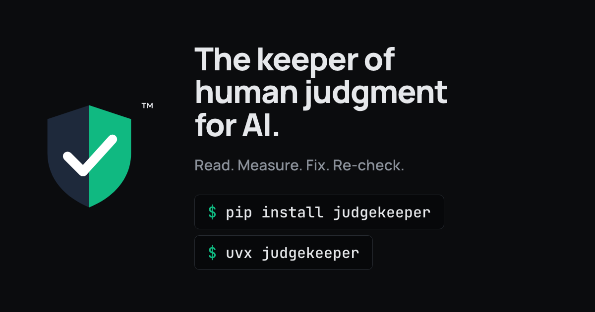

<p align="center">
  <a href="https://github.com/judgekeeper/judgekeeper">
    
  </a>
</p>

<p align="center">
  <a href="https://www.judgekeeper.com"><b>Website</b></a> ·
  <a href="https://www.judgekeeper.com/start.html"><b>Guide</b></a> ·
  <a href="https://github.com/judgekeeper/judgekeeper"><b>Code</b></a> ·
  <a href="https://pypi.org/project/judgekeeper/"><b>PyPI</b></a>
</p>

An LLM-as-a-judge is an AI model that grades another model's answers. **judgekeeper** shows how often yours agrees with you, and where it goes wrong. It is open source (Apache-2.0) and runs on your own computer.

<p align="center">
  
</p>

### The 5 steps

1. **Find.** Find your eval results and the LLM-as-a-judge that graded them.
2. **Mark.** Mark your answers Pass or Fail in your browser.
3. **Measure.** See how often your LLM-as-a-judge agrees with you.
4. **Fix.** Write a better rule and test it on marks kept aside.
5. **Re-check.** Change your LLM-as-a-judge and see if it still agrees with you.

### Install

In your project folder, in its virtual environment:
```
pip install judgekeeper
judgekeeper
```
Or, with no virtual environment: `uvx judgekeeper`.

Works with promptfoo, DeepEval, Inspect AI, MLflow or your own CSV, TSV or JSONL file.
